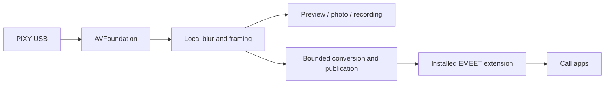

# Pixy Control

A local macOS camera controller written in Rust for the **EMEET PIXY**. Configure the camera, frame your video, blur your background, and send the processed image to other apps through an already installed EMEET virtual camera extension.

No account, cloud processing, network service, or telemetry. Background segmentation runs on the Mac with Apple Vision and Core Image. This is an independent project, not affiliated with or endorsed by EMEET.

**Early development:** tested with one PIXY on Apple Silicon. Hardware compatibility and call-app behavior need validation on additional machines. This repository contains original application source; it does not include EMEET installers, binaries, SDKs, firmware, or its camera extension.

[Guia em português](docs/USO.pt-BR.md) · [Contributing](CONTRIBUTING.md) · [Security](SECURITY.md)

## Features

| Area | Controls |
| --- | --- |
| Camera | Manual, firmware tracking, privacy, pan/tilt, eight presets, startup position |
| Image | Focus, exposure, white balance, brightness, contrast, saturation, sharpness, anti-flicker |
| Framing | Digital zoom, crop, rotation, mirror, aspect ratio, four-corner perspective |
| Effects | Adjustable local background blur with person segmentation |
| Capture | Live preview, PNG photos, hardware-encoded H.264 video, optional microphone, recording segments |
| Sharing | Processed output through the installed EMEET virtual camera, persistent pause/resume session |
| Privacy | Idle detection, return to previous Manual/Tracking mode, manual privacy lock |

Availability depends on the firmware and video mode. Firmware tracking and gestures run locally on the camera. Beauty effects, cloud features, streaming platforms, and accounts from the vendor app are excluded.

## Requirements

- Apple Silicon Mac; macOS 14 or later APIs. Current runtime testing was on macOS 27.
- EMEET PIXY USB device `328f:00c0`. Other EMEET models are not selected automatically.
- Rust 1.97.0 (pinned in `rust-toolchain.toml`), Cargo, and Xcode Command Line Tools.
- FFmpeg on `PATH` or at `/opt/homebrew/bin/ffmpeg` for recording. Preview and controls do not require FFmpeg.
- **For virtual output only:** the EMEET STUDIO camera extension must already be installed and approved through the vendor's normal macOS installation flow. Pixy Control does not install or distribute it.

Close EMEET Studio while using Pixy Control; the camera's HID interface can be exclusive.

## Build and run

```sh
git clone https://github.com/ndelanhese/pixy-control.git
cd pixy-control
cargo test --locked
cargo clippy --all-targets --locked -- -D warnings
./build-app.sh "$PWD/dist/Pixy Control.app"
open "dist/Pixy Control.app"
```

Build the `.app` and launch it normally so macOS can show camera and microphone permission requests. The bundle is signed ad hoc for local use, not Developer ID signed or notarized. No prebuilt release is promised by this repository.

## Teams, Meet, and other apps

1. Leave Pixy Control running and enable **V-Cam → Ativar câmera virtual**.
2. In the call app, select **EMEET STUDIO Virtual Camera**.
3. Configure framing and **Efeitos → Desfocar fundo** in Pixy Control.

Selecting the physical **EMEET PIXY** bypasses the software crop and blur. Hardware controls still go directly to the camera.

The installed extension accepts **1920×1080 at 30 fps**. Selecting 4K in Pixy Control sets its physical capture format, not the format requested by every other application. Call apps may scale or compress the video independently. A 30 fps transport does not imply 30 different frames when blur or other processing produces fewer.



### Automatic privacy

Enable **V-Cam → Privacidade automática**. A visible foreground preview and recording count as use. After confirmed idle, the app enters firmware Privacy and remembers Manual/Tracking. A later consumer wakes the camera and restores that mode. Brief client renegotiations have a hold period before USB capture is released.

Manual privacy remains locked until you explicitly choose Manual or Tracking. Unknown usage is never treated as confirmed idle. Automatic privacy requires Pixy Control to remain running; this is not an OS-wide guarantee after quitting or crashing. Closing the main window exits the application.

### Performance

Conversion runs separately from the fixed 30 Hz output clock. A bounded two-frame reserve absorbs conversion jitter. Pixel buffers and the video format description are reused; repeated/neutral frames reuse immutable pixels. Without consumers, conversion and publication stop; after five confirmed idle seconds, the producer transport is suspended and resumes when usage returns. Connected clients keep the same active session through capture pauses. Background/minimized UI work is reduced.

4K blur costs more than 1080p. For lower resource use, choose 1080p and disable blur when unnecessary. Hardware encoding requires VideoToolbox; recording reports an error instead of silently falling back to a slower software encoder.

## Data and privacy

Settings and preset thumbnails are stored under `~/Library/Application Support/Pixy Control`. Captures default to `~/Movies/Pixy Control`. The app has no cloud upload or telemetry code; your chosen call app controls any transmission of its camera input.

Do not attach camera photos, recordings, serial numbers, personal paths, or unredacted diagnostic dumps to public issues.

## Development and validation

```sh
cargo fmt --check
cargo test --locked
cargo clippy --all-targets --locked -- -D warnings
cargo build --release --locked
```

Unit tests exercise protocol parsing, transforms, local composition, privacy ownership, bounded queues, output timing, and cancellation. They do not prove real camera behavior or successful Teams/Meet calls. CI does not open a physical camera, move motors, or reset firmware.

Explicit hardware/virtual diagnostics are documented in the [Portuguese guide](docs/USO.pt-BR.md). Run synthetic virtual tests only without external clients: their test patterns appear on the virtual output. Hardware diagnostics can change camera controls; read their scope before running. Factory reset requires a separate confirmation in the application.

## License

Original project code is licensed under the [MIT License](LICENSE). Dependencies retain their own licenses. EMEET product names and trademarks belong to their owners; the vendor extension is a separate prerequisite and is not covered by this project's license.
